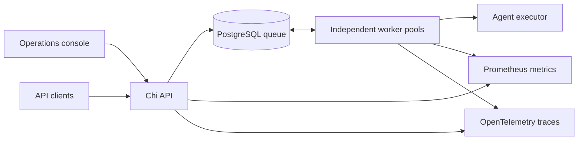

# Forge

### Agent Execution Engine

A Go workflow engine designed for cloud deployment, coordinating agent tasks
across worker pools, enforcing execution budgets, and exposing operational state
through a unified control plane.

**Go · PostgreSQL · Chi · Docker · OpenTelemetry · Prometheus**

## Cloud deployment

The reference AWS architecture places an HTTPS control plane on ECS Fargate,
with independent worker services backed by PostgreSQL. Its default topology is
two API replicas and ten worker replicas, each with 256 task slots. Credentials
come from Secrets Manager, application logs flow to CloudWatch, and workers run
in private subnets.

The [deployment template](deploy/aws/stack.yaml) and
[cloud setup guide](docs/cloud-deployment.md) cover image publishing, TLS,
credential configuration, database migrations, and service rollout. Cloud hosting
is the planned deployment target; provisioning is managed by the operator.

## Capabilities

- **Dependency-aware orchestration.** Validated workflow DAGs with parallel task
  execution, dependency ordering, and failure propagation.
- **Durable task coordination.** PostgreSQL queues with atomic claims, expiring
  leases, bounded retries, and protection against stale worker results.
- **Execution guardrails.** Per-attempt token and runtime budgets, cooperative
  cancellation, and terminal circuit-breaker outcomes.
- **Operations console.** Workflow inspection, submission controls, worker
  capacity, execution history, and deployment configuration in one interface.
- **Operational visibility.** Prometheus metrics for attempts, completions,
  budgets, and latency; optional OpenTelemetry traces for requests and tasks.
- **Controlled API access.** Bearer authentication, idempotent submission,
  strict validation, and bounded request handling.

## Architecture



The control plane and workers scale independently. Workers claim eligible tasks,
renew leases during execution, and publish results only while their claims remain
valid. Expired claims become eligible for recovery within the attempt limit.
Token and runtime breaker failures remain terminal.

Execution uses at-least-once delivery across lease recovery. External effects must
be idempotent. The included executor is a deterministic agent simulator;
additional adapters must preserve budget and cancellation semantics.

## Documentation

| Guide | Coverage |
| --- | --- |
| [Cloud deployment](docs/cloud-deployment.md) | AWS architecture, infrastructure template, and release procedure |
| [Getting started](docs/getting-started.md) | Installation, execution modes, and configuration |
| [Operations console](docs/console.md) | Workflow controls, worker views, and dashboard data scope |
| [HTTP API](docs/api.md) | Workflows, authentication, idempotency, and cancellation |
| [Observability](docs/observability.md) | Metrics, trace export, and worker monitoring |
| [Container deployment](docs/containers.md) | Service topology, secrets, and monitoring configuration |
| [Testing](docs/testing.md) | Unit, concurrency, and PostgreSQL integration tests |
| [Load testing](docs/load-testing.md) | Reproducible workloads, measured results, and benchmark scope |

## Development

```sh
go mod download
go test -race ./...
go vet ./...
go build -o bin/forge ./cmd/forge
```

Tests cover execution, budget enforcement, worker lifecycle, API behavior, and
telemetry. The PostgreSQL integration suite separately exercises persistence,
concurrent claims, lease recovery, and cancellation against a database instance.

## Run locally

With Go 1.24 or newer installed:

```sh
go mod download
go run ./cmd/forge -mode demo
```

Open `http://127.0.0.1:8080` for the console. Demo mode runs ten embedded worker
pools with an in-memory queue and simulated agents; no cloud credentials or
database are required. See [getting started](docs/getting-started.md) for more
configuration options.
