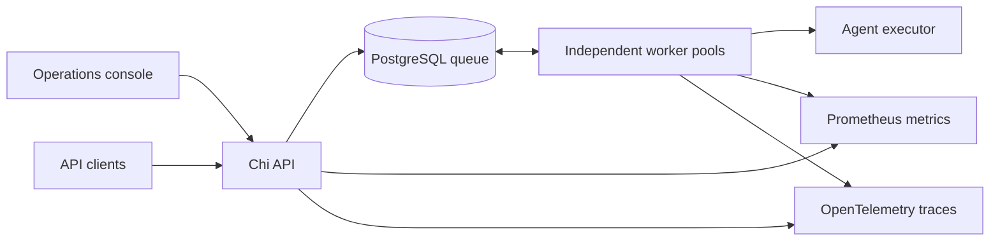

# Forge

### Agent Execution Engine

A Go workflow engine for coordinating agent tasks across worker pools, enforcing
execution budgets, and exposing operational state through a unified control plane.

**Go · PostgreSQL · Chi · OpenTelemetry · Prometheus**

## Capabilities

- **Dependency-aware orchestration.** Validated workflow DAGs with parallel task
  execution, dependency ordering, and failure propagation.
- **Durable task coordination.** PostgreSQL queues with atomic claims, expiring
  leases, bounded retries, and protection against stale worker results.
- **Execution guardrails.** Per-attempt token and runtime budgets, cooperative
  cancellation, and terminal circuit-breaker outcomes.
- **Operations console.** Workflow inspection, submission controls, worker
  capacity, execution history, and deployment configuration in one interface.
- **Operational visibility.** Prometheus metrics for attempts, completions,
  budgets, and latency; optional OpenTelemetry traces for requests and tasks.
- **Controlled API access.** Bearer authentication, idempotent submission,
  strict validation, and bounded request handling.

## Architecture



The control plane and workers scale independently. Workers claim eligible tasks,
renew leases during execution, and publish results only while their claims remain
valid. Expired claims become eligible for recovery within the attempt limit.
Token and runtime breaker failures remain terminal.

Execution uses at-least-once delivery across lease recovery. External effects must
be idempotent. The included executor is a deterministic agent simulator;
additional adapters must preserve budget and cancellation semantics.

## Documentation

| Guide | Coverage |
| --- | --- |
| [Getting started](docs/getting-started.md) | Installation, execution modes, and configuration |
| [Operations console](docs/console.md) | Workflow controls, worker views, and dashboard data scope |
| [HTTP API](docs/api.md) | Workflows, authentication, idempotency, and cancellation |
| [Observability](docs/observability.md) | Metrics, trace export, and worker monitoring |
| [Testing](docs/testing.md) | Unit, concurrency, and PostgreSQL integration tests |

## Development

```sh
go mod download
go test -race ./...
go vet ./...
go build -o bin/forge ./cmd/forge
```

Tests cover execution, budget enforcement, worker lifecycle, API behavior, and
telemetry. The PostgreSQL integration suite separately exercises persistence,
concurrent claims, lease recovery, and cancellation against a database instance.

[Source repository](https://github.com/jdw004/forge)
